# DNS management

A name for your connection – free or with your own domain – that follows your IPv4 and IPv6 by itself, plus all DNS
records of your domains right at Cloudflare, deSEC, Hetzner, INWX or IONOS (A, AAAA, CNAME, MX, TXT, SRV, CAA) with
templates, checks, DNSSEC status and zone files. Other extensions use the service, e.g. the mail server for
SPF/DKIM/DMARC and Let’s Encrypt for wildcard certificates (dns-01).

[Deutsch](README.de.md) · An official [Hostwerk](https://github.com/Passimoritz/hostwerk-public) extension (SDK 2.7, native extension)

## What it does

- **Where:** Go live → Make reachable → DNS, the address card of every Minecraft server and – new – the section “DNS records” of a web server – no own sidebar entry since 1.2.0; the full page stays under Extensions → Open
- **Set up a name** – assistant with two ways: *“I have no domain”* (free name, step by step with the sign-up link, paste
  the token) or *“I have a domain”* (pick the provider, connect, optionally let one name follow this connection)
- **Maintenance-free names**: every 5 minutes Hostwerk looks at the public address (several sources without an account;
  an IPv4 counts once two agree; for IPv6 the fixed address of this PC, not the changing privacy address) and updates a
  name **only when it changed** – never more than once a minute. Every 6 hours it checks with public resolvers that the
  name really points here and sets it again if not. Provider down → growing pauses (5 min … 6 h), 429 → waits at least
  as long as the provider says, wrong or expired token → no more tries until you change it. Problems come as **one**
  notification (Settings → Notifications, “DNS names are not updated”) and show up in Hostwerk’s self-maintenance; every
  change is in the name’s history
- Records A, AAAA, CNAME, MX, TXT, SRV and CAA: add, change, delete, filter; right-click on a row
- **Templates**: website with and without www, name for a Hostwerk web server, Minecraft (A/AAAA + SRV when the port is not
  25565), mail basics (MX, SPF, DMARC), CAA for Let’s Encrypt – addresses are replaced, nothing is added twice
- **Check / propagation**: asks Cloudflare, Google, Quad9 **and the provider’s own name server** – so you see “the provider
  has it, the world is still waiting for the TTL”
- **DNSSEC status** per zone (on, DS missing at the registrar, off, broken) – with the DS records from deSEC to copy
- **Zone files**: export (BIND format) and import from your old provider – only missing records are added
- Mail server records (SPF/DKIM/DMARC/MX) of the mail server extension with one click
- Credentials and tokens encrypted with Hostwerk’s secret key, never sent to the interface

## Providers

| Provider | Costs | Domain needed? | Maintenance-free | What you need |
|---|---|---|---|---|
| **DuckDNS** | free | no (`name.duckdns.org`) | yes | Token (sign in with GitHub/Google/Reddit/X) |
| **deSEC** (`dedyn.io`) | free (non-profit) | no (`name.dedyn.io`) – also own domains | yes | Token; DNSSEC included, all record types |
| **dynv6** | free | no (`name.dynv6.net` …) | yes | HTTP token |
| **FreeDNS** (afraid.org) | free | no (many shared domains) | yes | Update token per record (A, AAAA) |
| **No-IP** | free hostname | no (`name.ddns.net` …) | **no** – confirm by e-mail every 30 days | User + password or DDNS key |
| **Cloudflare** | DNS free (Free plan) | yes – the domain costs money at a registrar | yes | API token (template “Edit zone DNS”); proxy switch |
| **deSEC** (own domain) | free | yes – domain at any registrar | yes | Token; name servers ns1.desec.io / ns2.desec.org |
| **Hetzner** | DNS free | yes – domain costs money | yes | API token of a Console project (“Read & Write”) |
| **INWX** | DNS included with domains there | yes – domain costs money | yes | User, password, optional TOTP secret; TTL ≥ 300 s |
| **IONOS** | DNS included with domains there | yes – domain costs money | yes | API key `prefix.secret` |

“Maintenance-free” means: after setting it up once you never have to do anything – as long as the provider keeps the
account. No-IP is offered only as an alternative and is clearly marked.

## Where it shows up in Hostwerk

| Place | What |
|---|---|
| **DNS** (own page) | Names, records, providers – the full management |
| **Live → DNS** (next to *Domains & HTTPS*) | Names with status and “update now”, the domains of your web servers with **Create DNS record** |
| **Minecraft → server → Connect** | The free name with port to copy, **Own address** creates A/AAAA (+ SRV) in your domain |
| **Live → Domains & HTTPS** | Hostwerk uses `ctx.dns.acme.create/remove` for wildcard certificates and without port 80 |

“Router & port forwarding” keeps its own simple DynDNS setting – it still works. A name is never updated by both: the DNS
page shows the router’s name and moves it here with **Keep it up to date here** (the token moves along encrypted, the
router setting is switched off).

## For other extensions: the service `dns`

The extension offers the service **`dns`** (`"provides": ["dns"]`). Native extensions reach it with
`await host.use('dns')` (or `host.ctx.dns`) and add `"uses": ["dns"]` to their manifest – Hostwerk then suggests the
pair. Names are always full names (`_dmarc.example.com`); the right account and zone are found by the longest match.

```js
const dns = await host.use('dns');

await dns.set({ name: 'example.com', type: 'TXT', content: 'v=spf1 mx -all' });          // → { action: 'created' | 'updated' | 'unchanged', record }
await dns.apply([{ name: 'example.com', type: 'MX', content: 'mail.example.com', priority: 10 }]); // many at once, one error does not stop the rest
await dns.remove({ name: 'www.example.com', type: 'A', content: '203.0.113.5' });      // → { action: 'removed' | 'missing' }
await dns.records('example.com');                                                      // records of the zone
await dns.verify({ name: 'example.com', type: 'MX', content: 'mail.example.com', priority: 10 }); // → { ok, some, results: [{ resolver, ok, values }] }
await dns.waitFor(record, { timeout: 180000 });                                        // until Cloudflare, Google and Quad9 see it
await dns.acme.create({ domain: 'example.com', name: '_acme-challenge.example.com', value }); // what Hostwerk itself calls (SDK 2.10)
const ip = await dns.names.ips();                                                      // { v4, v6 } of this connection
dns.names.list();                                                                      // names that follow this connection, with status
```

`set()` never creates duplicates: TXT records with a tag (`v=spf1`, `v=DMARC1`, `v=DKIM1` …) replace the old one under the
same name, MX replaces the same target (new priority), CNAME replaces the name; everything else is only added if it is not
there yet. Pass `{ replace: false | 'tag' | 'type' }` to choose yourself.

Record format: `{ name, type, content, ttl, priority }` – `content` for MX/CNAME is the host name, for TXT the plain text
(long DKIM keys are split into 255-character pieces automatically), for SRV `"weight port target"` (priority separately),
for CAA `0 issue "letsencrypt.org"`.

### Mail server (SPF, DKIM, DMARC)

The page shows the records of the extension “Mail server” (`ctx.mailserver.domains(id)`) with a ✓ for each one that is
already at the provider and sets the missing ones with one click. A mail server can do the same itself:

```js
const dns = await host.use('dns');
const records = (await mailserver.domains(id)).flatMap((d) => d.records.map((r) => ({
  name: r.name, type: r.type,
  ...(r.type === 'MX' ? { content: r.value.split(' ')[1], priority: Number(r.value.split(' ')[0]) } : { content: r.value }),
})));
await dns.apply(records);
```

### Let’s Encrypt with dns-01 (wildcard certificates)

`dns.acme` has the two functions `acme-client` expects. The TXT record is added next to existing ones (domain and wildcard
need two values under the same name), Hostwerk waits until the public resolvers see it, and afterwards removes only its own
value:

```js
const cert = await client.auto({
  csr, email, termsOfServiceAgreed: true,
  challengePriority: ['dns-01'],
  challengeCreateFn: dns.acme.challengeCreateFn,
  challengeRemoveFn: dns.acme.challengeRemoveFn,
});
```

For an own ACME implementation, `dns.acme.txtValue(keyAuthorization)` gives the TXT value (base64url of SHA-256).

## Limits

- DuckDNS, dynv6 and FreeDNS only take A/AAAA (DuckDNS one TXT) through their update interface – other records are edited on
  their website. deSEC names can carry every record type here.
- FreeDNS: each record has its own update token (IPv6 needs a second one).
- No-IP: free names must be confirmed by e-mail every 30 days – Hostwerk cannot do that.
- IPv6: a name only gets an AAAA record when the fixed IPv6 of this PC is reachable from outside (same /64 as the address
  the internet sees). Without IPv6 to the outside existing AAAA records stay untouched.
- The check talks to public resolvers over DNS (UDP/TCP 53) and – for DNSSEC – over DNS-over-HTTPS (Cloudflare, Google).
- Hostwerk’s own certificate function (*Live → Domains & HTTPS*) uses `ctx.dns.acme.create/remove` since Hostwerk 2.12; older
  versions only know http-01.
- The mail server extension does not set its records itself yet – use the button on the Providers tab or `dns.apply()`.
- Zones are cached for 5 minutes; *Reload* fetches them again.

## Install

In Hostwerk: **Extensions → Discover** and click “Install”.

Native extensions run as part of Hostwerk (own server and interface part). That is why Hostwerk only installs them from the official catalogue (with checksum) or in developer mode.

## Data

`data/dns/dynamic.json` – names that follow this connection, their status and history; tokens sealed like the provider credentials.

`data/dns/accounts.json` – provider accounts; API tokens and passwords sealed with Hostwerk’s secret key (`config/secret.key`). Removing the extension deletes nothing.

## Develop

```bash
node --test tests/*.test.js          # tests
node build-native.js .               # build the interface (sdk/build-native.js from hostwerk-public)
node check.js . --strict             # same check as the catalogue (sdk/check.js)
```

Interface source in `ui/src`, server part in `server/`. Texts in the code are English, German is in `locales/de.json`.

## License

MIT
